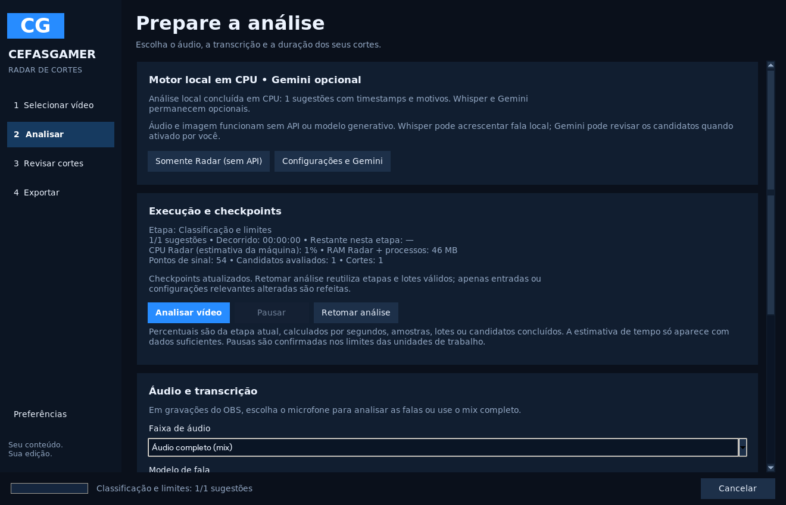

# Cefas Radar de Cortes 2.0

Aplicativo desktop em português para revisar gravações longas de gameplay e localizar intervalos aproveitáveis. Processa localmente em CPU, oferece faixas OBS, análise sonora/visual, transcrição opcional, pontuação explicável, revisão manual e exportação. Não prevê viralização nem reconhece semanticamente acontecimentos de jogos.

**Estúdio de Legendas — versão 0.7.0:** reutiliza a transcrição Whisper/cache, permite corrigir texto e tempos por bloco/palavra, personalizar quatro estilos, salvar presets e exportar SRT, ASS ou MP4 com legendas. Inclui prévia sincronizada, áudio preservado e projeto editável. Veja o [guia do Estúdio de Legendas](docs/ESTUDIO_LEGENDAS.md).

A [Fase 3](docs/FASE3.md) permanece: timeline com ondas reais e prévia, favoritos/classificação, cortes manuais, projetos .radar.json e MP4 horizontal/vertical com recorte ou fundo desfocado. A distribuição 0.6.0 já passou na validação nativa Windows.

A [Fase 2](docs/FASE2.md) mantém áudio externo com sincronização manual, expressões do canal, indicadores de intensidade/ritmo/pausas e contexto da fala. A versão 0.6.0 passou nos testes nativos do código, EXE, instalação, aplicativo instalado e desinstalação.

A base da [Fase 1](docs/FASE1.md) permanece: motor local em CPU, sem chave/API obrigatória, checkpoints por etapa/lote, pausa/retomada, métricas reais e fila MP4 recuperável. Whisper e Gemini são opcionais. A [auditoria inicial](docs/AUDITORIA_2_0.md) registra a arquitetura anterior.

## Instalação com assistente (recomendada)

[Baixar Radar de Cortes 0.6.0 para Windows x64](https://github.com/PedroHenrique1788/Radar/releases/download/v0.6.0/RadarCortes-Setup-0.6.0-Windows-x64.exe) · [Notas da versão e checksums](https://github.com/PedroHenrique1788/Radar/releases/tag/v0.6.0)

Baixe o arquivo **RadarCortes-Setup-…-Windows-x64.exe** na [página de versões](https://github.com/PedroHenrique1788/Radar/releases). Execute-o, conclua o assistente e abra **Radar de Cortes** no Menu Iniciar. A Área de Trabalho pode receber um atalho opcional. Não baixe “Source code” para esse modo de instalação.

O pacote inclui Python, FFmpeg/FFprobe/FFplay e o modelo `tiny` de transcrição em CPU. O uso básico funciona sem instalar dependências nem baixar modelos na primeira abertura. `base` e `small` continuam opcionais e precisam de download. FilmCraft é um aplicativo separado, opcional.

Instala por usuário, sem exigir administrador. Caches, logs e resultados ficam em `%LOCALAPPDATA%\RadarCortes`, separados dos arquivos instalados. O desinstalador aparece nas configurações de aplicativos do Windows e preserva vídeos e dados do usuário. O instalador ainda não é assinado com certificado comercial; o Windows pode identificar o editor como desconhecido. Confira a origem e o SHA-256 publicado.

### Gerar o instalador

A automação [Instalador Windows](https://github.com/PedroHenrique1788/Radar/actions/workflows/windows-installer.yml) executa em Windows x64 quando uma tag `v*` é enviada ou quando iniciada manualmente. Instala dependências, verifica SHA-256 do FFmpeg, inclui o modelo `tiny` em revisão fixa, roda os testes, empacota com PyInstaller e gera o assistente Inno Setup. Executa testes reais no EXE e no aplicativo instalado, incluindo GUI, mídia sintética, transcrição de uma amostra de português, VAD e exportação. Só publica uma release após esses testes passarem. Instalação silenciosa e desinstalação também são verificadas. Artefatos incluem manifesto de componentes e SHA-256.

As dependências de build estão em `packaging/requirements-build.txt`, entradas/receita em `packaging/` e a automação em `.github/workflows/windows-installer.yml`. Para testar o pacote manualmente: `RadarCortes.exe --self-test C:\caminho\relatorio.json`. O relatório informa falhas sem depender de uma janela de console.

## Instalar pelo código-fonte no Windows 10/11

1. Instale **Python 3.12 de 64 bits** (3.11 também aceito) pelo [python.org](https://www.python.org/downloads/windows/). Inclua **Tcl/Tk**, pip e Python Launcher. Não use o Python embutido de outro aplicativo.
2. Instale FFmpeg a partir dos links de builds Windows da [página oficial](https://ffmpeg.org/download.html). Extraia e adicione a pasta `bin` ao `PATH`; abra um novo terminal e confirme `ffmpeg -version`, `ffprobe -version` e `ffplay -version`. Se preferir, configure `FFMPEG_PATH`, `FFPROBE_PATH` e `FFPLAY_PATH` com os caminhos completos dos executáveis.
3. Extraia/clone este projeto e dê duplo clique em **instalar.bat**. O instalador cria `.venv` e instala dependências gratuitas. Não exige CUDA ou uma chave de API.
4. Abra **iniciar.bat** e selecione uma gameplay. O padrão **off** analisa áudio/imagem sem modelo ou API. Se ativar Whisper pelo código-fonte, seus pesos podem precisar de download; no instalador tiny já acompanha o pacote. A revisão Gemini é adicional e exige ativação explícita nas preferências.

Use `tiny` no i7-8565U com MX110; `base` ou `small` consomem mais tempo e memória. A MX110 não é exigida. O FFmpeg precisa de libx264 e codificador AAC, presentes nos builds usuais.

## Usar

1. **Selecionar vídeo** (MP4, MKV, MOV ou AVI). Nenhuma chave é necessária. O perfil **Modo Econômico — Lenovo MX110** usa CPU, processamento sequencial, duas threads, limite de memória e amostragem reduzida.
2. Escolha o microfone OBS para transcrição/análise sonora ou **Áudio completo (mix)**. A escolha afeta a análise; os MP4 exportados preservam todas as faixas de áudio.
3. Configure quantidade (1–20) e duração e clique em **Analisar vídeo**. Acompanhe etapa, unidades processadas, CPU/RAM e tempo. **Pausar/Retomar** mantém a unidade atual; **Cancelar** conserva etapas/lotes confirmados. **Retomar análise** e **Análises recentes** permitem continuar depois, revalidando original/configurações. Se ativado em Preferências, Gemini compara até 20 candidatos automaticamente após a análise local.
4. Em **Revisar cortes**, clique em um resultado para ler a justificativa, os componentes da pontuação e a transcrição. A aba **Gemini** mostra a avaliação das falas; a tabela usa o título sugerido pela IA sem substituir o título local no objeto do corte. **Por potencial** prioriza notas Gemini válidas e usa o score local nos cortes sem revisão. **Por tempo** ordena cronologicamente. Ctrl permite selecionar vários cortes.
5. **Reproduzir** cria uma prévia temporária recodificada e abre FFplay. Os campos **Início no original** e **Fim no original** aceitam `HH:MM:SS.mmm`; clique em **Aplicar limites** para alinhar aos quadros originais. O score permanece o da análise anterior após ajustes manuais.
6. **Copiar tempos**, exportar **JSON/CSV**, **SRT** ou **MP4**. O vídeo original é protegido. Um MP4 existente só é substituído após confirmação e após concluir a exportação; relatórios e legendas usam destinos novos. Em Exportar, escolha original, horizontal ou vertical, qualidade e legendas. Todas as faixas de áudio do original são preservadas.
7. Na aba **Timeline**, marque IN/OUT e use **Criar** para um corte manual; **Ondas** carrega os picos reais da janela visível. Organize favoritos e classificação na aba **Organizar**. **Salvar** conserva a revisão em um projeto .radar.json; **Projetos do estúdio** permite reabri-lo sem nova análise.
8. No **Estúdio de Legendas**, selecione o Short, clique **Gerar legendas**, corrija os blocos e escolha Clássico, Palavra Destacada, Pop/Zoom ou Karaokê. Confira o quadro no cursor ou reproduza até seis segundos com áudio. Exporte SRT/ASS/MP4 e salve o projeto para manter as legendas editáveis, sem API paga.

A pontuação combina gancho lexical, variação sonora relativa, atividade visual e contexto lexical. Os pesos são configuráveis e normalizados conforme os sinais disponíveis; os motivos mostram pontos e pesos efetivos. Alto ≥70, médio ≥45, baixo <45. Volume constante e silêncio não são forçados a gerar destaques. A nota representa relevância interna, sem confirmar emoção, acontecimentos do jogo ou viralização. Podem existir menos sugestões do que o solicitado ou nenhuma.

## Tempos, memória e precisão

Todos os tempos usam o **primeiro quadro do vídeo original como zero**. HH:MM:SS.mmm é uma representação de segundos, não timecode SMPTE. PTS inicial e atraso das faixas são preservados. WAVs mono 16 kHz são limitados por lote de até cinco minutos; a transcrição recebe o deslocamento original de cada lote. Os limites dos lotes ainda podem prejudicar frases. Amostragem visual padrão: 0,5 quadro/s em 64×36, configurável; mede diferenças sem reconhecer semanticamente ações. Não é uma lista exaustiva de cenas.

A análise percorre o arquivo inteiro, em lotes, mantendo sinais compactos e fala em memória. O uso ainda cresce com a duração; não há garantia de duração ilimitada. WAV mono em cache usa aproximadamente 115 MB/h; FilmCraft gera aproximadamente **691 MB/h por faixa** estéreo PCM 48 kHz. Garanta espaço e consulte o [guia da Fase 1](docs/FASE1.md) antes de apagar cache referenciado por projetos. Não há benchmark em gravações reais de muitas horas neste ambiente.

Os limites sugeridos são alinhados aos PTS de quadros próximos usando FFprobe. Em VFR, índices de quadro no JSON são **nominais**, não índices reais; utilize os tempos. A detecção de VFR por taxas médias é apenas indicativa. Transcrição e amostragem visual não garantem a fronteira perfeita de uma frase: revise cada corte. A exportação FFmpeg recodifica por timestamps em vez de copiar por keyframes; a precisão final é limitada pelos quadros/amostras existentes. Em arquivos com origem temporal zero, a exportação busca perto do intervalo para evitar decodificar horas anteriores. Arquivos com offsets usam o caminho conservador para preservar sincronismo. A publicação do MP4 funciona também sem hard links (exFAT/FAT32/compartilhamentos); FAT32 continua limitado a arquivos de 4 GB. Imagens com dimensões ímpares recebem até 1 pixel de borda para compatibilidade H.264.

Os checkpoints ficam em `temporarios/jobs/<source_id>/`, por etapa/lote, com integridade e escrita atômica. O ID inclui caminho, tamanho, mtime e amostras do início/fim; não é hash integral do vídeo. Configurações, ferramentas e modelo invalidam apenas etapas relevantes. Falhas não apagam resultados anteriores. Bloqueios evitam escritores simultâneos do mesmo trabalho. Veja os limites de validação e armazenamento no [guia da Fase 1](docs/FASE1.md). Logs em `temporarios/radar.log`.

## FilmCraft

Baseado na [documentação oficial de agentes](https://github.com/storytold/filmcraft/blob/main/docs/agents.md), [protocolo de controle](https://github.com/storytold/filmcraft/blob/main/docs/control-protocol.md) e importador OTIO. Validado com **CLI 0.18.0 para Linux e Windows x64**, incluindo abertura de projeto no FilmCraft desktop Windows pelo teste do executável empacotado. Esse fluxo FilmCraft é local e não usa API de IA.

1. Instale o FilmCraft desktop oficial no Windows. A CLI acompanha o MSI, normalmente em `%LOCALAPPDATA%\Programs\ArtCraft\FilmCraft\filmcraft-cli.exe` ou `C:\Program Files\ArtCraft\FilmCraft\filmcraft-cli.exe`.
2. Clique em **Conectar ao FilmCraft**. O Radar procura esses locais e o PATH, ou permite selecionar o executável do editor, a CLI ou usar a opção “Escolher instalação FilmCraft…”. Consulta o registro do instalador e lembra a instalação selecionada. Também aceita `FILMCRAFT_CLI`. Confere `--help` e os esquemas reais de `file.import` e `sequence.settings` antes de editar.
3. Na etapa **Exportar**, selecione os cortes e use **Selecionados em um projeto** para criar um projeto novo com uma sequência por Short. **Todos em um projeto** usa todos os resultados; **Um projeto por Short** gera um `.fcproj` por corte encontrado. Escolha uma pasta de saída. Cada operação cria uma subpasta própria, permitindo repetir exportações sem colidir nem alterar projetos anteriores.
4. O Radar gera timelines OTIO, WAVs auxiliares e um roteiro JSONL. A CLI importa o vídeo original, os áudios sincronizados, define títulos/resolução/FPS e salva `.fcproj` com `--save-as`. Em seguida reabre o projeto para conferir sua leitura. Preserve os WAVs, timelines e vídeo original nos mesmos locais. O projeto referencia mídia, não a incorpora.
5. **Abrir projeto para edição** inicia o FilmCraft localizado junto à CLI (ou a associação de arquivos do Windows). Revise e exporte no editor.

Cada faixa de áudio OBS é convertida em um WAV estéreo separado, com atraso original preservado. Isso evita depender do mapeamento implícito de faixas do importador e permite ajuste de volume no editor. Faixas com mais de dois canais são reduzidas a estéreo. A timeline pode somar microfone+mix e duplicar sons se a gravação já contiver ambas as versões; revise mute/ganho.

**Sem CLI:** os mesmos botões criam `.otio` com vídeo, faixas e intervalos; importe pelo menu de importação do FilmCraft. Não se fabrica um `.fcproj` nem se declara projeto nativo salvo nesse modo. Versões antigas podem não aceitar extensões de metadados OTIO de resolução: confira as configurações da sequência.

O MCP oficial (`filmcraft-cli mcp`) e o canal JSON (`filmcraft --control 9876`) foram investigados. A criação usa a CLI headless para manter a sessão atual do usuário intacta. Nenhum projeto existente é alterado; os comandos sempre partem de uma sessão nova. O módulo possui uma função de inspeção local, limitada a leitura, para o canal JSON: aceita apenas `127.0.0.1` e lê `FILMCRAFT_CONTROL_TOKEN` do ambiente, sem gravá-lo em logs ou argumentos. Caso use esse canal manualmente, gere 64 caracteres hexadecimais aleatórios para cada sessão e herde a mesma variável nos processos. O Radar não precisa desse token para o fluxo normal via CLI.

Limites: VFR é representado pela taxa nominal do editor, portanto revise arredondamentos no FilmCraft. Preservação de HDR, colorimetria avançada, rotação de metadados, pixel aspect ratio não quadrado e áudio multicanal não foram validados; a versão inicial se destina a gameplay SDR com pixels quadrados. O teste Windows abre um projeto num processo isolado do FilmCraft desktop e confirma a leitura pelo canal oficial de controle. Isso verifica a abertura, não todas as funções de edição manual. O servidor MCP não foi exercitado. A abertura nativa e exportação pela CLI Linux foram testadas.

## Desenvolvimento e testes

Python 3.12 + FFmpeg/FFprobe, Tkinter, NumPy, faster-whisper (CTranslate2 CPU int8) e OpenTimelineIO. Dependências diretas fixadas em `requirements.txt`; as transitivas são resolvidas pelo pip. Tkinter vem com Python no Windows; no Linux é um componente do sistema. As dependências e a GUI são verificadas em Python 3.12 Linux e Windows x64. PyAV é fixado em 16.0.1 porque a versão 19 removeu um argumento usado pelo faster-whisper 1.2.1; há um teste de decodificação real para detectar essa incompatibilidade. Os BAT de instalação pelo código-fonte não são executados na automação; o instalador pronto usa PyInstaller e Inno Setup.

```bash
python -m venv .venv
# Linux:
.venv/bin/python -m pip install -r requirements-dev.txt
.venv/bin/python -m pytest -q
.venv/bin/python -m radar
# Modo sem interface:
.venv/bin/python -m radar video.mp4 --model off --track mix --min 15 --max 60 --output resultados/relatorio.json
# Para testar FilmCraft de verdade (caso contrário só esse teste é marcado skip):
FILMCRAFT_CLI=/caminho/filmcraft-cli .venv/bin/python -m pytest -q
# Interface com display real ou Xvfb:
DISPLAY=:99 FILMCRAFT_CLI=/caminho/filmcraft-cli .venv/bin/python -m pytest -q
```

No Windows, substitua `.venv/bin/python` por `.venv\Scripts\python.exe`. Para um modelo já baixado, a CLI aceita `--model C:\modelos\faster-whisper-tiny`. No ambiente cloud, o primeiro download está sujeito à allowlist do Hugging Face. Nenhuma chave é necessária para modelos públicos. Falha de transcrição gera aviso e continua com áudio/imagem; não equivale a transcrição validada.

Testes geram mídia sintética com FFmpeg e verificam leitura, duas faixas OBS, duração, HH:MM:SS.mmm, offsets, VFR, ausência de áudio/fala, falha de transcrição, offsets entre blocos de 300 s, cancelamento, seleção/deduplicação, relatórios, SRT, limites dos quadros e sincronismo após recodificação. A integração real usa três intervalos conhecidos, salva/reabre `.fcproj` e verifica sequências, faixas e tempos; exporta cada sequência pela CLI e confere duração, imagem e sincronismo dos tons. O teste de GUI verifica metadados, seleção, detalhes, cópia e ajuste assíncrono.

O teste de deslocamento entre blocos usa um transcritor simulado; ele não mede reconhecimento de fala. Separadamente, o teste do executável Windows carrega os pesos incluídos e transcreve uma amostra sintética conhecida de português com o modelo real, em modo offline. Esse teste confirma funcionamento básico, sem medir a qualidade em gravações reais de gameplay.

## Organização e próximos passos

`radar/model.py`: tempos/dados; `media.py`: FFprobe/extração; `signals.py`: features; `transcription.py`: fala em blocos; `candidates.py`: candidatos/pontuação; `pipeline.py`: fluxo/cache; `export.py`: MP4/CSV/JSON/SRT; `filmcraft.py`: integração; `gui.py`: interface; `__main__.py`: GUI/CLI.

Segunda etapa: análise semântica multimodal local e mensurada, avaliação em gameplay real, sobreposição entre blocos para frases nas fronteiras, ajuste de pontuação com avaliação humana, cache por etapas e retomada fina, player integrado com waveform, edição vertical opcional, detecção precisa de VFR e preservação completa de HDR/multicanal. Antes de distribuir, testar em Windows 10/11 com vídeos reais do OBS e modelos de fala.


## Revisão pelo ChatGPT e API

O botão **Copiar para ChatGPT** copia uma solicitação com os cortes selecionados, horários, transcrição e critérios locais. Cole o conteúdo numa conversa no ChatGPT e peça revisão de contexto e pesquisa de tendências, com fontes e datas. O arquivo de vídeo e seu caminho privado não são incluídos nesse texto. Esse botão apenas copia o texto; o envio e a revisão desse fluxo são manuais naquela conversa.

**[ChatGPT Plus](https://help.openai.com/en/articles/6950777-what-is-chatgpt-plus) e API têm cobranças separadas.** O Plus não fornece créditos para chamadas de API de um aplicativo externo. Além da revisão manual no ChatGPT, o Gemini participa do fluxo com chave própria e autorização explícita antes de ativar a revisão automática. Cota/cobrança permanecem sob controle do projeto Google. Pesquisa de tendências ajuda a embasar uma avaliação editorial, sem garantir viralização nem produzir probabilidades de engajamento não medidas.

### Atualização 0.1.4

Correções de exportação em sistemas de arquivos sem hard links, repetição de projetos na mesma pasta, detecção/persistência da instalação FilmCraft, ambiente de DLLs para processos externos no executável empacotado, mensagens copiáveis e confirmação do destino dos arquivos. A interface seleciona o primeiro resultado automaticamente, preserva seleção ao ordenar e adapta os controles a telas menores. Projetos individuais usam todos os cortes; “Enviar cortes selecionados” respeita a seleção. A automação Windows agora usa a CLI oficial real e testa também projetos conjuntos, individuais e abertura no editor a partir do aplicativo empacotado.


## Transcrição do corte em TXT

Após analisar com `tiny`, `base` ou `small`, selecione um corte e clique em **TXT** na revisão ou **Transcrição TXT** na etapa Exportar. O arquivo UTF-8 contém início/fim do corte e apenas as falas correspondentes ao intervalo, com horários do vídeo original. Se ajustar os limites, a exportação usa os novos limites, e não o texto antigo do candidato.

Quando há tempos por palavra, os termos fora do corte são excluídos. Palavras parcialmente ouvidas nas bordas são sinalizadas para revisão. Se faltarem tempos por palavra, segmentos que atravessam os limites são omitidos com observação, evitando incluir frases externas como se pertencessem ao corte. Se não houver fala transcrita, o aplicativo explica o motivo e não cria um TXT vazio. **Exportar SRT** continua disponível para legendas com tempos relativos ao corte.

## Interface CefasGamer e Gemini opcional

A navegação agora segue quatro etapas: **Selecionar vídeo → Analisar → Revisar cortes → Exportar**. O azul foi indicado pelo proprietário do canal. Em **Preferências**, é possível ajustar nome/cor e carregar seu logotipo PNG. O monograma CG é apenas o padrão do aplicativo; não é uma cópia do logotipo do canal. O layout mantém as ações avançadas fora da tela principal. A imagem na prévia é um quadro de referência; **Reproduzir** abre o trecho com áudio no player FFplay.



[Ver a revisão dos cortes locais](docs/fase1-revisao.png). As capturas não medem desempenho no computador do usuário.

### Configurar sua própria chave Gemini

1. Em **Preferências → Gemini**, cole uma chave nova do Google AI Studio no campo protegido visualmente. Uma chave compartilhada em conversa deve ser revogada/substituída. Nenhuma chave pessoal acompanha este repositório ou o instalador.
2. **Guardar chave** mantém a chave apenas na sessão. Se marcar **Salvar protegida para este usuário do Windows**, ela será cifrada com Windows DPAPI, no escopo do usuário atual, em `%LOCALAPPDATA%\RadarCortes\config\gemini_key.dpapi`. Ela não entra no JSON comum de preferências. No Linux, use a chave na sessão ou `GEMINI_API_KEY`; não há gravação de chave em texto puro. **Remover chave salva** apaga a cópia protegida e a chave da sessão; uma variável de ambiente configurada fora do app permanece sob controle do usuário.
3. Clique em **Validar e listar modelos** e escolha um modelo da sua conta. A lista vem do Google, sem fixar um modelo que possa ser descontinuado. Isso verifica acesso à lista, sem consultar saldo, preços, cota restante ou garantir que `generateContent` estará liberado.
4. Clique em **Usar Radar + Gemini** para autorizar a revisão automática desta sessão. Quando a transcrição estiver desligada, tiny é selecionado para fornecer as falas ao Gemini. A navegação e a análise local continuam disponíveis sem esta configuração. Mesmo com chave salva, Gemini exige validação/ativação por sessão; mudanças de chave/modelo/pesquisa exigem nova autorização para envio automático.
5. Analise normalmente. O Radar prepara até 20 candidatos; o Gemini compara as falas e ordena os melhores. A seleção final pode diferir da preferência da heurística local. Somente horários, transcrição e critérios locais dos candidatos são enviados; caminho privado e vídeo ficam fora da requisição. Há uma solicitação de revisão por análise, sem trocas de modelo ou repetições automáticas após erro.
6. Leia a aba **Gemini**. A nota editorial aparece separada da pontuação local. Limites, IDs e nota local não são alterados. Alterar limites/transcrição invalida a revisão daquela versão do corte. **Revisar seleção** permite uma nova avaliação manual. É possível salvar a revisão em JSON na etapa **Exportar**.

Se a validação ou revisão falhar, o aplicativo oferece **Continuar só com o Radar**, **Aguardar e tentar depois** ou **Configurar Gemini**. O primeiro continua nesta sessão usando a classificação local; o segundo mantém os candidatos e transcrições em memória sem novas chamadas. **Retomar fluxo** repete somente a etapa Gemini, sem analisar novamente o vídeo. Se o Google enviar `Retry-After`, esse prazo é respeitado antes da tentativa manual; ele não garante liberação da cota. HTTP 429 indica limite de uso, enquanto erros de autorização e indisponibilidade têm mensagens distintas. Selecionar outro vídeo ou analisar novamente substitui os candidatos pendentes do vídeo anterior.

Sem transcrição, o app oferece continuar localmente ou corrigir a análise e não chama a API. Sem candidatos, a revisão não é solicitada. Gemini compara o texto dos candidatos encontrados pelo Radar; não assiste ao vídeo inteiro nem corrige o reconhecimento do áudio.

**Cota gratuita e faturamento são controlados pelo projeto no Google.** O app não consulta saldo nem consegue garantir uma chamada gratuita ou impedir cobranças de um projeto com faturamento ativo. Confira preços, cotas e faturamento pelo botão **Conferir cota no AI Studio**, especialmente antes de habilitar **Google Search**. O app não ativa faturamento, não troca automaticamente de modelo e não repete chamadas após erro.

A pesquisa é opcional e desativada por padrão. Quando o Google retorna referências de grounding, o app mostra os links. Se não vierem referências, indica que não há pesquisa confirmada; não trata links inventados no texto como fontes verificadas. A avaliação continua editorial: contexto e tendências não garantem viralização. O fluxo **Copiar para ChatGPT** continua disponível para revisão manual sem integração de API.

Os testes do cliente Gemini usam respostas controladas e não consomem a chave/cota do usuário. Foram verificados formato REST conforme o SDK oficial, envio limitado aos trechos, limites de tamanho, erros 400/401/403/404/429/503, ausência de chave em URL/JSON/erros, cancelamento, validação de IDs/notas e separação entre nota local e editorial. O teste do pacote Windows também verifica o cliente sem rede e o armazenamento DPAPI. Esses testes não comprovam a validade de uma chave real ou a cota atual da sua conta; use o botão de validação para isso.
