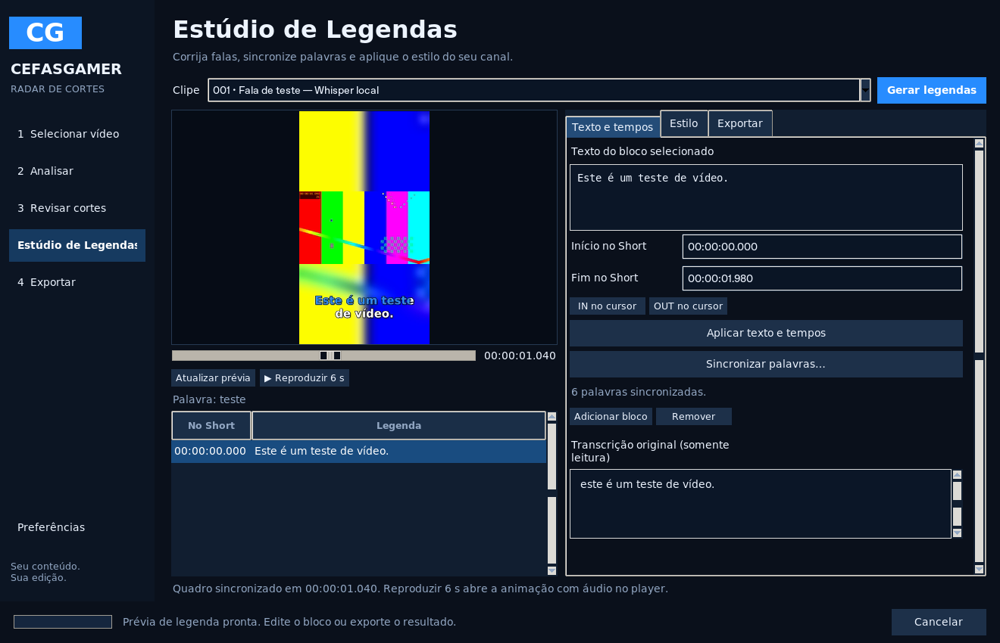
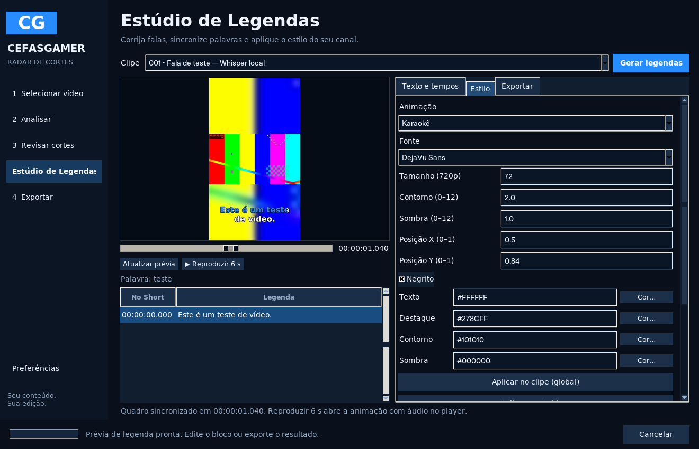

# Estúdio de Legendas — 0.7.0

O editor usa a transcrição Whisper do Radar, com uma faixa editável por corte. Não exige API, assinatura ou GPU dedicada. A análise, o editor da Fase 3 e o FilmCraft continuam disponíveis.

## Usar

1. Selecione um Short em **Revisar cortes → Legendas → Abrir Estúdio de Legendas**, ou use **Estúdio de Legendas** no menu e escolha o clipe.
2. Clique em **Gerar legendas**. O Radar reutiliza as falas em memória ou o cache compatível. Se faltarem dados, usa o Whisper local somente no áudio ainda não transcrito desse Short. Com transcrição desligada na análise, o estúdio usa `tiny`; no instalador ele já está incluído. A faixa de áudio e o microfone externo seguem a seleção da análise.
3. Escolha um bloco para corrigir texto e início/fim. Os campos aceitam segundos (`1.240`) ou `HH:MM:SS.mmm`, sempre relativos ao Short. **IN/OUT no cursor** copia o instante da prévia. **Adicionar bloco** cria uma legenda manual no cursor, em uma região livre; **Remover** elimina o bloco selecionado.
4. Na aba **Estilo**, escolha **Clássico**, **Palavra Destacada**, **Pop/Zoom** ou **Karaokê**. Ajuste fonte, tamanho, cores, contorno, sombra, negrito e posição. X/Y vão de 0 a 1. Também pode clicar na imagem para posicionar a legenda do bloco.
5. **Aplicar no clipe (global)** muda o padrão; **Aplicar neste bloco** cria uma personalização individual. **Usar global neste bloco** remove essa personalização. Alterar o padrão não apaga estilos individuais. **Salvar como preset** guarda o estilo neste computador; ao carregar um preset, aplique-o no bloco ou no clipe.
6. Mova o cursor e use **Atualizar prévia**: um quadro do vídeo é renderizado com o mesmo libass da exportação. O bloco ativo e a palavra correspondente aparecem junto à imagem. **Reproduzir 6 s** abre uma prévia de até seis segundos com animação e áudio no FFplay. O player usa uma janela própria.
7. Em **Exportar**, escolha formato, resolução e qualidade e use **MP4 final**, **SRT** ou **ASS**. Desative **Legendas ativadas neste clipe** para exportar sem gravação de texto; os dados permanecem editáveis e os arquivos SRT/ASS ainda podem ser exportados.
8. **Salvar projeto editável** conserva texto, tempos, palavras, estilos globais/individuais e ativação em `.radar.json`. Edite e exporte novamente a qualquer momento. Alterações pendentes são aplicadas ao trocar de bloco/clipe, pré-visualizar, salvar ou exportar; um campo inválido precisa ser corrigido antes de continuar.

## Sincronização e palavras

O Whisper existente já solicita `word_timestamps=True`. A faixa editável mantém segundos do vídeo original internamente; a prévia, o SRT, o ASS e o MP4 subtraem o início atual do corte. Mudar os limites de um Short não acumula deslocamentos. Palavras fora do novo intervalo são excluídas e as que atravessam a borda são limitadas ao trecho disponível.

Corrigir palavras sem mudar sua quantidade mantém os tempos conhecidos. Ajustar o intervalo do bloco move esses tempos junto com a edição manual. Mudar a quantidade de palavras remove a associação antiga: use **Sincronizar palavras** para informar os novos tempos em segundos do Short. Não são criados timestamps estimados para palavras novas. Sem tempos utilizáveis, Palavra Destacada e Karaokê mostram o bloco com aparência clássica; Pop/Zoom continua funcionando no bloco. O painel informa essa condição.

Os blocos não podem se sobrepor; tempos e textos são validados antes de salvar ou renderizar. Se o modelo não fornecer palavras, frases que atravessam uma borda não são incluídas automaticamente, pois não há como separar com precisão o que foi dito dentro do corte. Amplie o corte ou ajuste manualmente. O reconhecimento do Whisper e seus tempos precisam de revisão humana.

## Exportação e desempenho

- **SRT**: texto e tempos em milissegundos, relativos ao Short. Não carrega cores ou animações.
- **ASS**: fontes, cores, posição, contorno, sombra e efeitos com precisão temporal de centésimos. As fontes precisam estar instaladas no computador que reproduz/renderiza o arquivo; libass pode substituir fontes ausentes.
- **MP4**: vídeo H.264 com a legenda renderizada por FFmpeg/libass em CPU. Mantém todas as faixas de áudio originais. Com **Preservar qualidade do áudio**, AAC/MP3/ALAC/Opus/FLAC/AC3/EAC3 compatíveis são copiados sem nova compressão; outros codecs usam ALAC ou PCM conforme a precisão original. PCM de 32 bits e áudio de ponto flutuante não são reduzidos a 24 bits. Isso pode aumentar o arquivo e ter suporte menor em alguns players; desligar a opção usa o AAC já existente no Radar. PCM em MP4 exige um FFmpeg recente, como o incluído no instalador. Áudio externo usado na análise não é adicionado automaticamente ao MP4.

Texto e estilos ficam separados do cache Whisper: nenhuma correção dispara ASR. A prévia renderiza apenas um quadro, limitado a 640 pixels no lado maior; a reprodução usa no máximo seis segundos nessa resolução. Resultados repetidos são reutilizados na sessão, com limpeza de quadros e fragmentos antigos. O MP4 completo é recodificado somente quando exportado ou solicitado no player antigo de revisão. A mudança de uma legenda invalida o arquivo correspondente na fila de exportação, preservando os MP4 anteriores.

O instalador inclui FFmpeg com libass. No código-fonte, verifique `ffmpeg -filters` e procure `subtitles`. Sem esse filtro, o editor e os arquivos SRT/ASS continuam disponíveis; a prévia com texto e o MP4 com legendas explicam a dependência faltante. Projetos da versão 0.6.0 são aceitos; os novos projetos usam versão 2 e exigem o leitor atualizado.

## Verificação

A [auditoria inicial](AUDITORIA_LEGENDAS.md) registra os componentes reutilizados. `tests/test_captions.py` verifica deslocamento de Short, cortes de palavras, edição/retempo, estilos globais/individuais, ativação, projetos antigos/novos, reutilização e cobertura incremental do cache, arquivos SRT/ASS/MP4, pixels dos quatro efeitos, sincronização da prévia, pacotes AAC originais, áudio atrasado com origem temporal diferente de zero e o fluxo real da interface.

Também foi executado o Whisper `tiny` real em CPU/int8, offline, na amostra sintética de português já usada pelo projeto: 4 blocos e 27 palavras com tempos, seguidos de SRT, ASS e MP4 vertical com fundo desfocado e Karaokê. Isso confirma o funcionamento do modelo, sem medir precisão em gameplay. As imagens acima são capturas da interface real com essa amostra de teste.

A validação do pacote Windows inclui os quatro estilos no EXE e no aplicativo instalado, prévia sincronizada, correção pela interface, arquivos e reabertura do projeto. A release só é criada após os testes nativos, instalação e desinstalação passarem.
