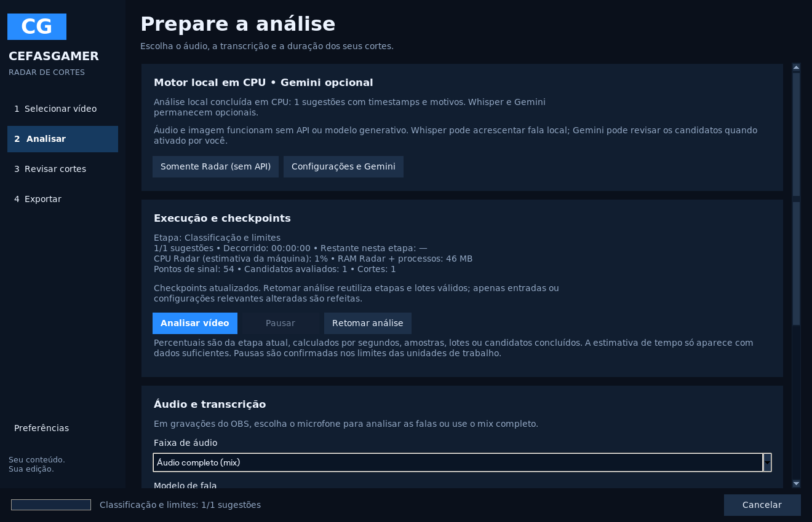

# Cefas Radar de Cortes 2.0 — Fase 1: motor confiável

Esta entrega evolui o aplicativo Python/Tkinter existente. Mantém FFmpeg, Faster-Whisper, notas e justificativas, ajustes de limites, MP4/JSON/CSV/SRT/TXT, FilmCraft oficial/OTIO e Gemini opcional. A [auditoria](AUDITORIA_2_0.md) registra o estado anterior e a suíte de 84 testes antes das alterações.

## Usar no Windows

Use o instalador x64 publicado somente após os testes Windows. Ele mantém o mesmo AppId/pasta por usuário, inclui Python/FFmpeg/modelo tiny e conserva dados em `%LOCALAPPDATA%\RadarCortes`. Pelo código-fonte: Python 3.12 x64 com Tcl/Tk, FFmpeg no PATH, `instalar.bat` e depois `iniciar.bat`. As dependências estão em `requirements.txt`; `psutil` foi acrescentado para CPU/RAM e controle dos subprocessos. Não há dependência de Ollama, CUDA ou API paga para o motor local.

1. Abra o Radar: ele inicia em **Selecionar vídeo**, no modo local, sem exigir chave.
2. Selecione a gameplay. Havendo uma única faixa identificada por nome como microfone/voz, ela é preferida; confira a escolha. O mix e as demais faixas continuam disponíveis. A análise escolhida não remove faixas dos MP4 exportados.
3. Em **Preferências**, aplique **Modo Econômico — Lenovo MX110** ou ajuste recursos, módulos e pesos. O padrão usa 2 threads (1 em máquina com um CPU lógico), 1 processo da tarefa, limite aproximado de 1024 MB, 0,5 amostra visual/s em 64×36 e lotes de até 300 s. Processamento sequencial; aumentar o teto de processos não cria execução paralela de etapas. Whisper começa em **off**; tiny/base são opções locais CPU/int8.
4. Configure quantidade/duração e clique **Analisar vídeo**. A execução informa a etapa, unidades processadas, tempo ativo, ETA por etapa quando houver amostras suficientes, CPU aproximada do Radar normalizada pela máquina, RAM do Radar e processos da tarefa, pontos de sinal, candidatos avaliados e cortes finais. Porcentagens se referem à etapa atual; atividade sem medição aparece indeterminada.
5. Use **Pausar** / **Retomar**. Subprocessos da tarefa são suspensos; código interno de bibliotecas coopera no limite da unidade atual. A interface mostra “pausa solicitada” até confirmação. **Cancelar** encerra subprocessos e mantém os lotes/etapas já confirmados.
6. Para continuar, use **Retomar análise** ou abra a entrada em **Análises recentes**. A mesma ação funciona após fechar/reabrir o aplicativo. Os parâmetros da análise são restaurados e podem ser ajustados antes de retomar. Arquivo e configurações são revalidados; mudanças refazem apenas o que depende delas.
7. Em **Revisar cortes**, veja tempos, componentes e motivos, selecione com Ctrl, reproduza ou ajuste limites. Sem sinais suficientes, pode não haver sugestões. Nenhuma emoção, explosão ou acontecimento de jogo é declarado como reconhecido.
8. Exporte um MP4 individual ou use **Exportar → Selecionados em fila**. Repita seleção e pasta para retomar. Arquivos concluídos são verificados por SHA-256 e reaproveitados; arquivos alterados pelo usuário são preservados, com uma nova versão de nome para a nova exportação. O formato desta fase mantém o enquadramento original, recodifica H.264/AAC e preserva todas as faixas.

Se uma etapa falhar, o erro identifica o módulo e a pasta dos checkpoints. **Retomar análise** tenta o trabalho pendente. Falhas de áudio/imagem permitem **Continuar sem este módulo**; se todos os sinais forem desativados, a configuração é recusada. Falha na fala preserva transcrições anteriores e permite terminar a classificação local, com aviso. Ajustar pesos ou threads não obriga a refazer extrações e sinais compatíveis.

## Persistência e limites

O cache JSON existente foi estendido em `temporarios/jobs/<source_id>/`. Um manifesto registra requisição, estado por etapa e erros. Registros atômicos por lote têm verificação de integridade. WAVs são pequenos por lote; um lote de 300 s mono 16 kHz/16 bits tem aproximadamente 9,6 MB, sem precisar criar um WAV gigante para a gameplay inteira. Dados concluídos permanecem após interrupção; o lote em execução pode precisar ser refeito. Escritas incompletas são descartadas na próxima abertura sob bloqueio exclusivo do arquivo de trabalho.

Etapas: identificação; extração; áudio; imagem; fala opcional; fusão; classificação/alinhamento; exportação. Cada etapa usa assinaturas próprias: mudar modelo Whisper não invalida a imagem; mudar amostragem não invalida o áudio; mudar pesos/duração/quantidade refaz a classificação. Binários FFmpeg/FFprobe e pesos locais do modelo também entram nas assinaturas relevantes.

O identificador original combina caminho, tamanho, mtime em nanossegundos e SHA-256 de amostras de até 1 MB no início e no fim. **Não é um hash criptográfico de todo o vídeo**: uma alteração só no meio que também preserve artificialmente tamanho e mtime pode passar despercebida. Nesse caso, remova manualmente o cache daquela análise. Mudanças normais e nos extremos são detectadas. CSV/JSON incluem esse identificador e o caminho original, além de tempos, duração, score, motivos e transcrição disponível.

O limite de RAM é uma guarda por observação de RSS, não uma reserva nem contenção instantânea do Windows; há intervalos entre verificações. Uma alocação nativa dentro de Whisper pode acontecer antes do próximo checkpoint. Os sinais crescem com a duração: não se promete duração ilimitada. O perfil limita buffers e modelos, não garante tempo de processamento em gameplay 1080p/4K. A análise visual é reduzida, mas o decoder ainda pode precisar decodificar quadros entre keyframes. Arquivos com PTS inicial não zero mantêm o caminho conservador de leitura para preservar o tempo, podendo ser mais lentos.

O espaço para o próximo WAV e uma margem de finalização são conferidos antes da extração. O cache persiste no disco e pode crescer; não há limpeza automática de análises antigas ou ferramenta de gestão de armazenamento nesta fase. Não apague o original nem os WAVs referenciados por projetos de edição. Bloqueios do sistema operacional impedem dois escritores de usar os mesmos checkpoints simultaneamente e são liberados após término/queda do processo.

## Pontuação

Os quatro pesos existentes — gancho lexical, variação sonora, atividade visual e contexto lexical — são configuráveis. Sinais indisponíveis são excluídos e os pesos restantes normalizados. A justificativa informa pontos e pesos efetivos. Áudio é comparado à mediana/variação do próprio arquivo e ao contexto próximo; volume constante não é automaticamente destaque. Imagem usa diferenças de quadros amostrados relativas à atividade do vídeo, incluindo atividade estática e possíveis transições, sem identificar objetos ou eventos. O contexto usa janelas anterior/posterior e limites de fala/palavra disponíveis. A nota é uma estimativa interna, não chance de viralização ou emoção confirmada.

## Linha de comando

```powershell
.venv\Scripts\python.exe -m radar gameplay.mp4 --model off --threads 2 --max-processes 1 --memory-mb 1024 --sample-fps 0.5 --batch-seconds 300 --output resultados\analise.json
.venv\Scripts\python.exe -m radar gameplay.mp4 --model off --threads 2 --sample-fps 0.5 --batch-seconds 300 --export-dir resultados\clipes --output resultados\analise.json
```

Ctrl+C cancela e preserva checkpoints. Reexecute o mesmo comando para retomar. Relatórios existentes recebem um novo nome numerado; não são sobrescritos. A fila revalida os clipes prontos antes de pular sua codificação.

## Arquivos e fases seguintes

- `profiles.py`, `control.py`: perfil CPU, validação, pausa/cancelamento, métricas e limites.
- `checkpoints.py`, `pipeline.py`: cache por etapa/lote, bloqueio, retomada e diagnóstico.
- `signals.py`, `transcription.py`, `candidates.py`: streaming, reuso de um modelo por chamada, cache independente e consultas temporais indexadas com lista preliminar limitada de candidatos.
- `desktop_analysis.py`, `gui.py`, `ui.py`, `__main__.py`: integração no desktop/CLI existentes.
- `export.py`, `model.py`: identificação dos originais, relatórios e fila MP4 recuperável.
- Empacotamento Windows preservado, com teste do cache e do início local sem API no executável.

Fase 2: áudio externo sincronizado, novos indicadores vocais/ritmo, frases configuráveis, fusão narrativa mais refinada e cortes por pausas/cenas validados. Fase 3: waveform/timeline, favoritos/classificação manual, novos cortes manuais, presets, exportação vertical 9:16, crop/fundo desfocado e organização de projetos. A cópia sem recodificação e suas limitações de keyframes também ficam pendentes. As exportações precisas existentes continuam recodificando; não se oferece “corte direto exato” fictício.

Os testes são registrados em [VALIDACAO.md](VALIDACAO.md). Não foi medido desempenho em uma gravação real longa no i7-8565U/MX110; um vídeo sintético de 30 minutos valida lógica temporal e lotes, não velocidade ou qualidade em gameplay real.


