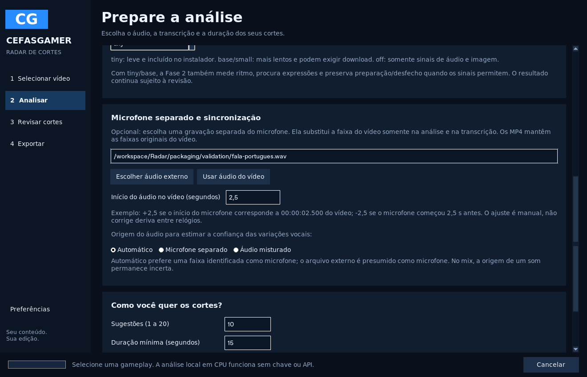
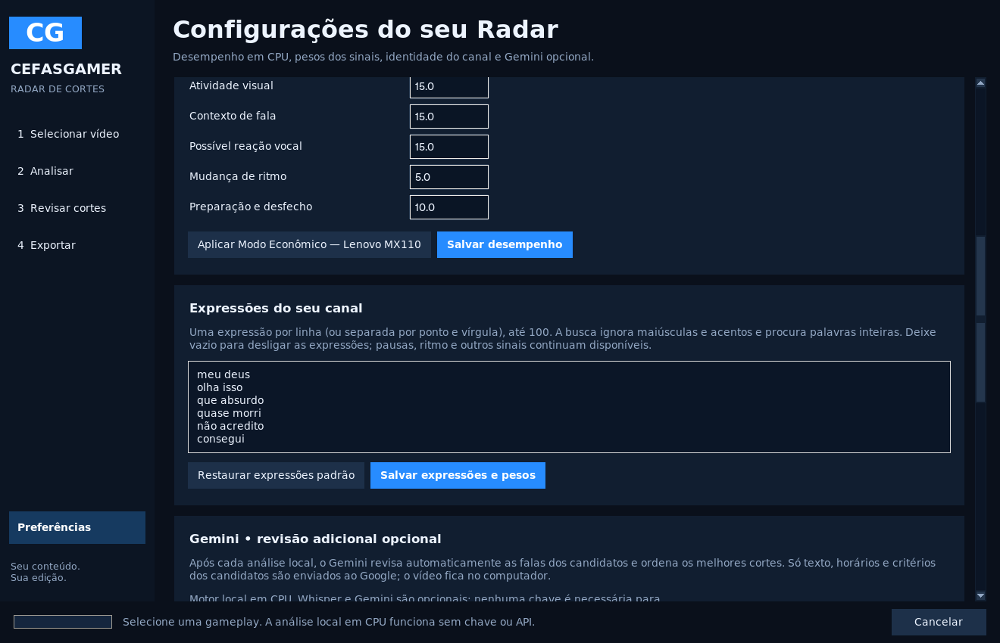

# Cefas Radar de Cortes 2.0 — Fase 2

Evolução da Fase 1 no mesmo aplicativo Python/Tkinter. A análise continua local, em CPU, sem Ollama, GPU ou API obrigatória. Faster-Whisper e Gemini são opcionais; nada ativa uma conta ou faz chamadas pagas automaticamente. O instalador inclui tiny. O modelo começa em `off` para preservar o perfil econômico; escolha `tiny` ou `base` para analisar as palavras e o ritmo.

## Microfone e sincronização

1. Selecione a gameplay. Uma única faixa nomeada Microfone/Mic/Voz é preferida automaticamente. Confira o seletor de faixa do OBS.
2. Se a voz estiver em outro arquivo, em **Analisar → Microfone separado e sincronização**, clique **Escolher áudio externo**. WAV, FLAC, MP3, M4A e outros formatos aceitos pelo FFmpeg funcionam. É usada a primeira faixa de áudio do arquivo externo.
3. Ajuste **Início do áudio no vídeo** em segundos. O mapeamento é `tempo no vídeo = tempo no áudio + ajuste`.
   - `+2,5`: o início da gravação do microfone corresponde a 00:00:02.500 do vídeo. Os primeiros 2,5 segundos recebem silêncio na análise.
   - `-2,5`: o microfone começou antes; os primeiros 2,5 segundos dele são descartados.
4. **Automático** considera o arquivo externo como microfone e usa o título de uma faixa única do vídeo para reconhecer um microfone. Se for um mix, marque **Áudio misturado**. O nome da faixa e a escolha manual são declarações de origem, não um detector de identidade vocal.
5. Ative **tiny** ou **base** para obter transcrição, palavras e ritmo; clique **Analisar vídeo**. Confira as falas e os horários originais em **Revisar cortes**.

O ajuste é manual e constante: não há correlação automática de gravações nem correção de deriva entre relógios. Arquivos sem faixa de áudio ou que não se sobrepõem ao vídeo são recusados com erro visível. Silêncio é acrescentado onde o microfone não cobre o vídeo. PTS inicial do áudio e do vídeo são tratados separadamente. Os lotes continuam usando a duração e os horários do vídeo original.

**O arquivo externo serve à análise/transcrição.** MP4, prévia e projetos FilmCraft preservam o áudio original do vídeo. Esta fase não faz dublagem/substituição das faixas exportadas. TXT/SRT refletem a fonte escolhida para transcrever: se o microfone só existe no arquivo externo, sua fala não estará audível no MP4 até que você a adicione no editor. Relatórios JSON/CSV registram a fonte e o ajuste para tornar essa diferença verificável.

Ao carregar outro vídeo, o campo externo é limpo. Ao reabrir a mesma análise, os parâmetros do último checkpoint são restaurados. O perfil econômico altera recursos sem apagar o microfone, o ajuste e as expressões já escolhidos.

## Expressões e sinais vocais

Em **Preferências → Expressões do seu canal**, informe uma expressão por linha ou separada por ponto e vírgula. Até 100 expressões de até 80 caracteres, sem programação de regex. A busca normaliza acentos, maiúsculas, espaços e pontuação; respeita palavras inteiras. Uma lista vazia desativa a busca personalizada. **Salvar expressões e pesos** persiste a configuração local.

O motor mantém sete componentes com pesos editáveis e normalização dos sinais disponíveis:

| Componente | Evidência usada |
| --- | --- |
| Gancho na fala | Expressões configuradas e pontuação interrogativa/exclamativa da transcrição |
| Variação sonora | Intensidade relativa ao arquivo e à janela anterior; volume constante não basta |
| Atividade visual | Diferença relativa entre quadros em baixa resolução |
| Contexto de fala | Texto contido no intervalo e terminação de frase; substitui a contagem simples anterior |
| Possível reação vocal | Variação de intensidade e envelopes de 20 ms durante fala, com pausas próximas; confiança menor no mix |
| Mudança de ritmo | Variação de palavras por segundo entre segmentos, somente com timestamps por palavra suficientes |
| Preparação e desfecho | Padrões lexicais transparentes, por exemplo “vou tentar” seguido de “consegui”, até 60 s depois |

Perfis anteriores com quatro pesos são migrados: os quatro valores são conservados e os três componentes novos recebem os padrões da Fase 2. Os motivos mostram os pesos efetivos após normalização. É possível zerar um componente para desativar sua contribuição.

Uma pausa antes de uma expressão é um indicador temporal, não emoção confirmada. Sem transcrição, um microfone declarado pode contribuir uma variação acústica conservadora; áudio misturado sozinho não recebe pontos de reação vocal. Mesmo com transcrição, um som simultâneo no mix pode vir do jogo, de música ou de outra pessoa. Não há reconhecimento de grito, riso, identidade, emoção específica ou acontecimento do jogo. A nota não representa probabilidade de viralização.

## Contexto e limites

As sugestões procuram preparação anterior e consequência posterior com as janelas configuráveis. Preparação/desfecho próximos são reunidos quando cabem no limite de duração; sugestões que cobrem a mesma sequência são consolidadas pela seleção com controle de sobreposição.

Limites próximos preferem pausas entre palavras/segmentos, bordas de frases e amostras de possíveis transições visuais. A cena é aproximada pela amostragem reduzida, não um detector quadro a quadro de alta precisão. Palavras cronometradas são preservadas. Sem tempos por palavra, o segmento é tratado como indivisível. Se uma frase longa não couber no máximo, o candidato pode ser descartado em vez de ser declarado completo.

O alinhamento final usa PTS reais do vídeo e verifica novamente se entrou numa palavra/segmento; tenta mover o limite para fora. Candidatos que continuem incompatíveis com os limites são descartados. A transcrição do corte é recalculada após o alinhamento; a revisão e as exportações usam o mesmo intervalo. A preservação depende da precisão da transcrição; tiny pode errar palavras e horários. Não se promete compreensão narrativa humana.

O Whisper pode estimar uma palavra antes do início físico do microfone. A Fase 2 limita segmentos/palavras à interseção real entre o arquivo externo e o vídeo, retirando palavras inteiras fora dessa cobertura. Isso evita declarar fala no silêncio acrescentado, mas não corrige todos os erros de temporização do modelo dentro do áudio disponível.

## Checkpoints e compatibilidade

As configurações novas fazem parte do pedido persistido. Identidade do áudio externo, ajuste e ferramentas entram na extração/fala; expressões, origem e pesos entram na classificação. Alterar o microfone ou ajuste refaz áudio/transcrição, preservando imagem compatível. Alterar expressões/pesos apenas reclassifica. O arquivo externo é revalidado ao salvar checkpoints e finalizar a análise. Mudança durante o processamento interrompe com diagnóstico, preservando etapas independentes.

Mantêm-se o bloqueio por análise, os arquivos atômicos, pausa/cancelamento/retomada, limites de recursos, transcrição opcional com falha recuperável e fila MP4 da Fase 1. Não há dependência nova nesta fase. Cache antigo permanece no disco; os novos envelopes usam uma assinatura diferente para não reutilizar registros sem esses indicadores.

## Executar

No instalador Windows: Menu Iniciar → **Radar de Cortes**. Pelo código-fonte: `instalar.bat`, depois `iniciar.bat`.

```powershell
.venv\Scripts\python.exe -m radar gameplay.mp4 --model tiny --track 2 --threads 2 --output resultados\analise.json
.venv\Scripts\python.exe -m radar gameplay.mp4 --model tiny --external-audio microfone.wav --audio-offset 2.5 --audio-role microphone --phrases "olha isso;consegui;batalha azul" --output resultados\analise.json
```

`--track` é o índice global mostrado pelo FFprobe, não a posição visual na lista. A opção externa tem precedência sobre a faixa do vídeo. Repetir o comando reaproveita checkpoints compatíveis. Acrescente `--export-dir resultados\clipes` para usar a fila MP4. `--model off` mantém a análise acústica/visual sem reconhecimento de palavras.

## Arquivos e validação

- `audio_source.py`: leitura de áudio externo e extração alinhada, inclusive silêncio antes/depois e PTS não zero.
- `intelligence.py`, `candidates.py`: expressões, ritmo, pausas, indicadores vocais e limites de contexto indexados por tempo.
- `profiles.py`, `pipeline.py`, `checkpoints.py`, `model.py`: parâmetros, proveniência, dependências e invalidação por etapa.
- `desktop_analysis.py`, `ui.py`, `__main__.py`: controles no fluxo existente e CLI.
- `signals.py`, `transcription.py`, `export.py`: envelopes leves, ASR restrito à cobertura real e relatórios com fonte do áudio.
- `tests/test_phase2.py`, `packaging/packaging_smoke.py`: sincronização real, retomada independente, critérios e integração no aplicativo empacotado.

Resultados e limitações dos ensaios estão em [VALIDACAO.md](VALIDACAO.md). Os exemplos sintéticos comprovam alinhamento e comportamento, não a qualidade editorial em gameplays reais. Nenhuma chave pessoal Gemini foi incluída ou consumida. O desempenho ainda não foi medido no Lenovo i7-8565U/MX110.

A evolução da Fase 3 está preparada no rascunho atual; veja o [guia do estúdio](FASE3.md): timeline/waveform, favoritos, cortes manuais, presets, exportação vertical, legendas no vídeo e projetos. SRT e ajustes dos cortes existentes continuam disponíveis. A publicação do instalador novo depende de validação Windows e autorização de publicação.




