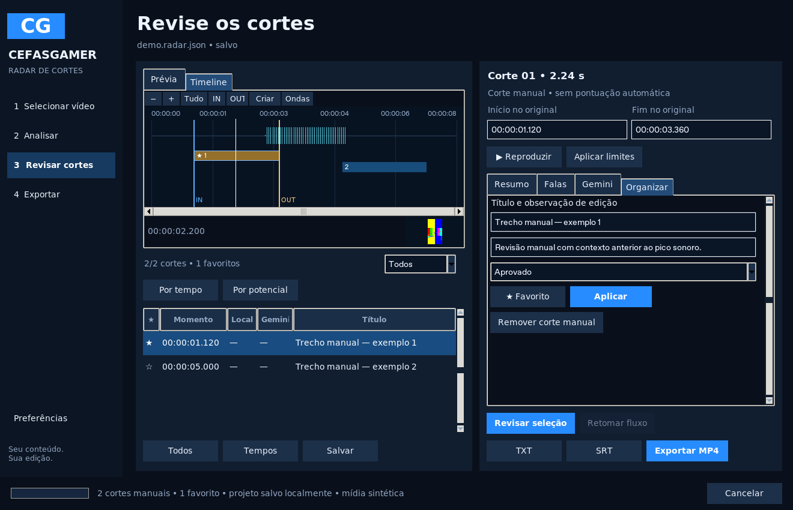
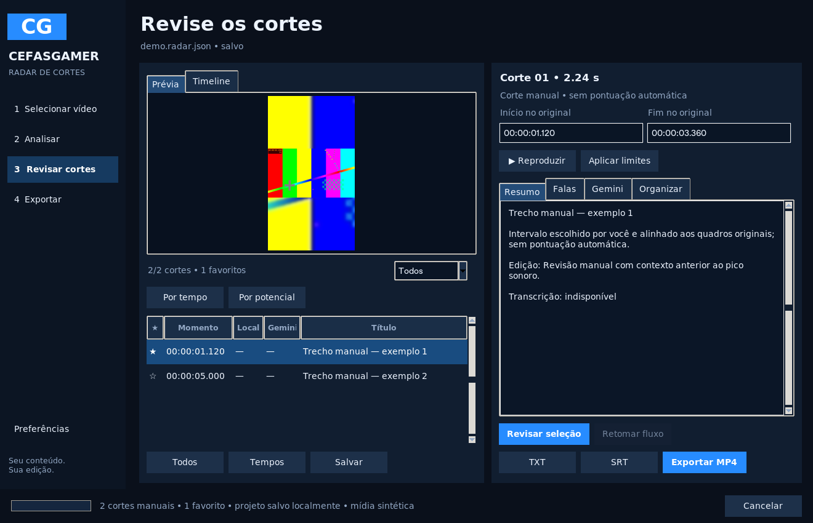
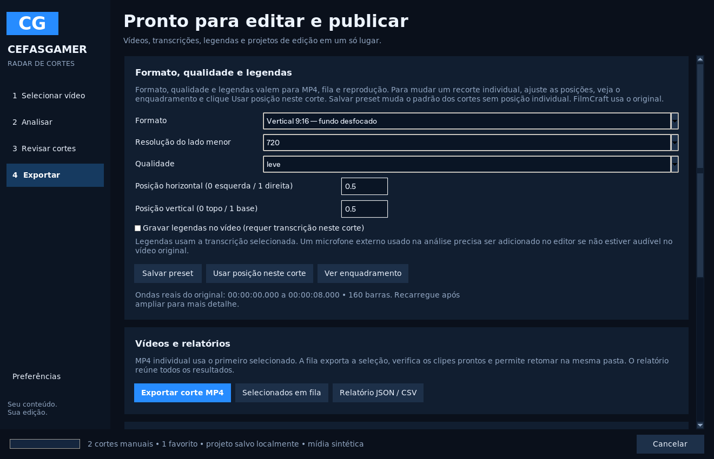

# Cefas Radar de Cortes 2.0 — Fase 3: estúdio de revisão

Versão **0.6.0**, sobre a Fase 2 existente. O envio ao GitHub e a publicação do instalador foram autorizados. O instalador só é liberado após os testes nativos do código, EXE, instalação, aplicativo instalado e desinstalação.

## Começar

Abra `iniciar.bat` depois de `instalar.bat`, ou execute:

```powershell
.venv\Scripts\python.exe -m radar
```

Selecione a gravação. Você pode **Analisar vídeo** e revisar sugestões ou **Abrir estúdio sem analisar** para criar cortes por conta própria. Não há chave, modelo generativo ou API obrigatória. Para obter falas e legendas automáticas, escolha tiny/base antes da análise. No instalador publicado anteriormente, o modelo tiny já acompanha o pacote; pelo código-fonte seus pesos podem precisar de download.

## Timeline e prévia

Em **Revisar cortes**, o painel esquerdo alterna entre **Prévia** e **Timeline**. A timeline inclui uma prévia pequena que acompanha o cursor. A prévia maior mostra o enquadramento; **Reproduzir** renderiza o corte temporariamente e abre o FFplay com áudio, formato e legendas configurados. Não é necessário exportar um arquivo definitivo para conferir o resultado.

- Clique na timeline para mover o cursor e carregar um quadro. A leitura do quadro é feita fora da interface e agrupada durante o arraste para evitar uma extração por movimento do mouse.
- **IN** e **OUT** usam o cursor para preencher início/fim. Arraste os marcadores ou use **Shift + arrastar** para marcar um intervalo. Os mesmos tempos aparecem nos campos da direita.
- **Aplicar limites** altera o corte selecionado; **Criar** gera um novo corte manual. As duas ações alinham os horários aos quadros reais do original.
- **+**, **−**, **Tudo** e a barra horizontal ampliam e deslocam a janela. Ctrl + roda do mouse também amplia.
- **Ondas** lê o áudio original da janela visível. Após ampliar ou deslocar, clique novamente para obter mais detalhe.

As ondas vêm de picos PCM reais do **mix do vídeo original**, não de uma ilustração ou da gravação externa do microfone. Vídeo sem áudio mostra silêncio. Cada janela tem até 2048 barras, com cache próprio; em uma gravação longa a visão geral tem menos detalhe temporal. Ao ampliar, recarregue apenas o intervalo que deseja inspecionar. A extração usa WAVs temporários de até 120 s, com buffers pequenos, sem carregar a gameplay inteira em RAM. Pausa e cancelamento continuam disponíveis.

O cursor indica um horário; a imagem é o primeiro quadro disponível nesse ponto. A confirmação dos limites usa PTS reais, inclusive em VFR. A prévia de enquadramento é estática e não mostra legendas; a reprodução temporária mostra a renderização completa. O cursor não acompanha o relógio do FFplay, que abre em janela própria.

## Favoritos, classificação e cortes manuais

A tabela marca favoritos com uma estrela e permite filtrar **Todos**, **Favoritos**, **Aprovados** ou **Pendentes**. **Todos** seleciona as linhas atualmente visíveis. Clicar num corte da timeline que esteja oculto pelo filtro volta a mostrar todos.

Na aba **Organizar**, edite título, observação e estado (Pendente/Aprovado/Descartado). **★ Favorito** marca ou desmarca a seleção; **Aplicar** guarda o texto e a classificação. **Remover corte manual** remove apenas um corte criado manualmente; para organizar uma sugestão automática, use Descartado.

Cortes manuais exibem **Manual**, sem uma nota automática de potencial. É possível criá-los antes de analisar o vídeo. Uma nova análise da mesma identidade do arquivo preserva cortes manuais, seus IDs, favoritos e revisões. Nas sugestões automáticas com os mesmos limites, preserva favoritos, classificação, enquadramento e títulos/observações explicitamente editados, atualizando a avaliação do detector. IDs conflitantes de novas sugestões são ajustados. No fluxo opcional Gemini, a seleção automática considera os candidatos automáticos e mantém os cortes manuais.

A classificação é organizacional: exportar usa a seleção explícita da tabela. Um corte marcado Descartado ainda pode ser exportado se você o selecionar. Salve o projeto para conservar suas alterações; abrir outro vídeo ou fechar sem salvar não cria um projeto automaticamente.

## Formato e qualidade

Em **Exportar → Formato, qualidade e legendas**, configure:

| Formato | Resultado |
| --- | --- |
| Original | Mantém o enquadramento original, com ajuste mínimo para dimensões pares |
| Horizontal 16:9 | 1280×720 ou 1920×1080; preserva o quadro com barras quando necessário |
| Vertical 9:16 — recorte | 720×1280 ou 1080×1920, preenchendo a tela com recorte fixo |
| Vertical 9:16 — fundo desfocado | Mesmo tamanho vertical, com o quadro inteiro sobre um fundo ampliado e desfocado |

Os presets **leve**, **equilibrado** e **qualidade** trocam tamanho/detalhe e tempo de codificação. O padrão continua equilibrado com formato original. A codificação é H.264/AAC em CPU; não depende da MX110.

Para um recorte individual, selecione o corte, ajuste as posições horizontal/vertical (0 a 1), clique **Ver enquadramento** e depois **Usar posição neste corte**. A posição fica gravada naquele corte e no projeto. A fila respeita posições individuais. **Salvar preset** define os padrões dos cortes que não têm posição própria. Não há rastreamento automático de rosto, câmera ou ação do jogo.

**Exportar corte MP4**, **Selecionados em fila** e **Reproduzir** usam os ajustes de formato/qualidade/legenda. A fila revalida saídas por SHA-256. Alterar formato, qualidade, enquadramento ou texto das legendas gera uma configuração separada; arquivos anteriores são preservados. O formato original padrão mantém compatibilidade com os checkpoints da fila anterior.

Todas as faixas de áudio do vídeo original são preservadas. O microfone externo da Fase 2 continua sendo apenas uma fonte de análise/transcrição: adicione-o no editor se precisar ouvi-lo no MP4. Projetos FilmCraft/OTIO continuam referenciando o original e não recebem um recorte vertical ou legendas gravadas automaticamente. Limites anteriores de HDR, rotação de metadados e pixels não quadrados continuam sem validação específica.

## Legendas

Marque **Gravar legendas no vídeo** para renderizar texto branco com contorno escuro. É preciso haver transcrição no intervalo; uma solicitação sem fala disponível retorna erro visível antes de criar um MP4 vazio.

Com tempos por palavra, os blocos são divididos por pausas, comprimento e duração para ficarem mais legíveis. SRT e vídeo usam os mesmos horários relativos ao corte. Palavras fora do intervalo ficam de fora; os horários são recalculados após ajustes. Sem tempos por palavra, apenas segmentos inteiros contidos no corte podem ser usados, e uma frase longa pode exigir revisão. O aplicativo não inventa horários proporcionais para palavras que não foram cronometradas.

Texto é tratado literalmente, sem aceitar comandos de formatação ASS embutidos na transcrição. A gravação usa libass do FFmpeg; pelo código-fonte, confira se o seu FFmpeg inclui o filtro `subtitles`. Revise o reconhecimento do tiny e os limites de palavras em cortes ajustados manualmente. TXT e SRT separados continuam disponíveis.

## Projetos

Use **Salvar**, na revisão, ou **Projetos do estúdio**, na primeira etapa. A extensão é **.radar.json**. O arquivo guarda referência e identidade do vídeo, cortes, favoritos, classificação, títulos/observações, transcrição, parâmetros de análise e presets/enquadramentos. Não inclui o vídeo nem credenciais Gemini. Projetos recentes aparecem na primeira etapa.

**Salvar projeto** atualiza atomicamente o projeto aberto. **Salvar como** cria uma cópia e preserva arquivos existentes. Uma falha ao finalizar a gravação mantém a revisão anterior. O limite é 32 MB e 2000 cortes por projeto.

**Abrir projeto** restaura a revisão sem repetir a análise ou chamar uma API. O vídeo original é conferido antes de usar os cortes. Se foi movido, o aplicativo oferece **Localizar vídeo original** e compara o conteúdo amostrado/tamanho antes de reconectar. Essa identificação segue as limitações de hash por amostras da Fase 1, não um hash de toda a gravação. Uma alteração normal no original é detectada. O teto de threads salvo é ajustado ao número de CPUs do computador que abre o projeto.

## Terminal

```powershell
# Analisar e exportar vertical com fundo desfocado e legendas
.venv\Scripts\python.exe -m radar gameplay.mp4 --model tiny --format vertical-blur --quality leve --burn-subtitles --save-project projetos\revisao.radar.json --export-dir resultados\verticais --output resultados\analise.json

# Exportar os favoritos aprovados de um projeto, sem analisar novamente
.venv\Scripts\python.exe -m radar --project projetos\revisao.radar.json --only-favorites --only-approved --export-dir resultados\aprovados --output resultados\aprovados.json

# Trocar formato/resolução; --no-burn-subtitles desativa legendas salvas
.venv\Scripts\python.exe -m radar --project projetos\revisao.radar.json --format vertical-crop --resolution 1080 --no-burn-subtitles --export-dir resultados\recortes
```

`--crop-x`/`--crop-y` ajustam o padrão; posições individuais do projeto têm precedência. Um vídeo posicional junto com `--project` permite localizar uma cópia movida do original. `--save-project` cria um novo arquivo e salva a revisão completa antes dos filtros de favoritos/aprovados.

## Implementação e verificação

- `timeline.py`, `waveform.py`: cursor, marcação, zoom/pan e picos reais com cache por janela.
- `desktop_studio.py`, `ui.py`, `gui.py`: estúdio integrado à navegação azul existente, prévia, organização e criação manual.
- `projects.py`, `model.py`: projetos versionados, gravação atômica e campos de revisão/enquadramento.
- `render.py`, `export.py`, `media.py`: formatos/presets, legendas, enquadramentos por corte, fila e diretório temporário seguro para renderização.
- `__main__.py`: formatos, projetos e filtros na CLI.
- `tests/test_studio.py`, `packaging/packaging_smoke.py`, receita/workflow: testes com mídia real e verificação do aplicativo empacotado.

Não há dependência nova em `requirements.txt`. O PyInstaller existente continua sendo ferramenta de build; a receita inclui explicitamente bibliotecas Tcl/Tk quando uma distribuição Linux mantém essas bibliotecas fora dos caminhos padrão. A configuração Windows continua com seus hooks e runtime próprios.

Resultados e limites estão em [VALIDACAO.md](VALIDACAO.md). Os ensaios e capturas usam mídia sintética. Não houve benchmark no Lenovo do usuário, avaliação editorial em gameplay real ou consumo de uma conta Gemini.






