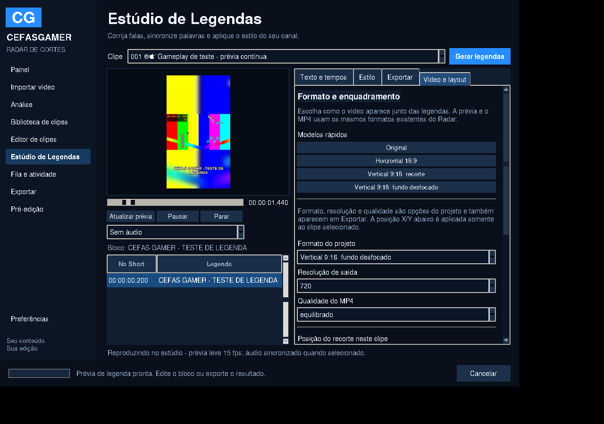

# Player contínuo e formato no Estúdio de Legendas

Evolução na branch `feature/studio-player-layout`, sobre a pré-edição 0.9. O pedido atual do usuário autoriza trazer o player e os controles de formato para esta etapa agora; isso não declara a versão 1.0 estável nem substitui a avaliação editorial pendente da 0.9.

## Usar o player dentro do estúdio

1. Importe o vídeo e selecione ou crie um clipe. Abra **Estúdio de Legendas**, pelo menu ou pela Biblioteca. As legendas existentes continuam editáveis; gerar uma transcrição nova não é requisito para reproduzir o vídeo.
2. No seletor de monitoração abaixo da imagem, escolha **uma faixa original** ou **Sem áudio**. O nome da faixa é a etiqueta da gravação, não identificação automática da voz. A seleção afeta somente o que você ouve na prévia; a exportação continua seguindo as regras existentes de preservação de faixas.
3. Clique **Reproduzir**. Imagem e áudio são reproduzidos no próprio Canvas da tela até o fim do clipe, sem o limite anterior de seis segundos e sem abrir o FFplay. O cursor, o horário e a indicação do bloco/palavra ativo acompanham a reprodução.
4. O mesmo botão alterna **Pausar** e **Retomar**. Com a prévia focada, a tecla Espaço também aciona esse controle. **Parar** interrompe a sessão e conserva o cursor para uma nova reprodução naquele ponto. Reproduzir ao chegar ao fim reinicia o clipe.
5. Arraste a barra de tempo para procurar outro ponto. O arraste interrompe a reprodução e prepara o quadro do novo cursor; clique **Reproduzir** para continuar dali. Uma prévia estática atrasada é cancelada ao iniciar a reprodução, evitando que interrompa a nova sessão.
6. **Atualizar prévia** continua disponível para conferir um quadro com o enquadramento e a legenda. Editar texto/estilo ou pedir outro quadro interrompe a reprodução atual. Trocar de clipe, sair da página ou fechar o Radar também encerra a sessão e libera seus recursos.

A indicação **Preparando reprodução** corresponde à abertura do decoder e, quando selecionado, do dispositivo de som. Um erro de áudio é exibido; o Radar não troca silenciosamente para reprodução muda. Confira a saída padrão do sistema ou escolha **Sem áudio** explicitamente e tente novamente. Essa escolha é útil em máquinas sem dispositivo de som, mas não comprova o sincronismo de uma saída audível.

## Escolher formato e enquadramento junto das legendas

A nova aba **Vídeo e layout** fica depois das abas existentes **Texto e tempos**, **Estilo** e **Exportar**. A ordem anterior dessas três abas foi preservada.

Os modelos rápidos usam os formatos que o Radar já exporta:

| Formato | Resultado |
| --- | --- |
| Original | Mantém o quadro original. |
| Horizontal 16:9 | Preserva o quadro numa saída horizontal, com bordas quando necessário. |
| Vertical 9:16 — recorte | Preenche a saída vertical com uma região do original. |
| Vertical 9:16 — fundo desfocado | Mantém o quadro completo sobre um fundo ampliado/desfocado. |

**Formato, resolução e qualidade são opções do projeto**, compartilhadas com a tela Exportar. Não são configurações independentes de cada clipe. Resolução 720/1080 e qualidade leve/equilibrado/qualidade afetam o MP4 final; a reprodução interativa usa sua própria resolução reduzida.

**X/Y são posições de recorte por clipe.** No vertical com recorte, 0 corresponde à esquerda/topo e 1 à direita/base. Use os sliders ou os campos, depois clique **Aplicar enquadramento neste clipe**. **Centralizar neste clipe** aplica X=0,5 e Y=0,5. Esses valores são guardados no clipe selecionado; mudar somente os campos ainda não salva um enquadramento individual. O formato com fundo desfocado mantém o quadro completo e não depende desse deslocamento do recorte.

Use **Ver prévia com este formato** para conferir a configuração. O recorte individual aplicado prevalece sobre o padrão do projeto, como na exportação existente. O quadro e o player usam os mesmos dados de formato, recorte e legendas que alimentam o MP4; a prévia reduzida não representa uma comparação pixel a pixel com o resultado final.

## Salvar, reabrir e exportar

Depois de aplicar o enquadramento e corrigir as legendas, use **Salvar projeto editável** ou o salvamento existente do estúdio. O projeto conserva os campos já existentes de renderização, posição do clipe e legendas; esta evolução não cria outro formato nem exige um novo esquema de projeto. Projetos antigos continuam abrindo pelo leitor existente.

Ao reabrir, selecione o clipe no Estúdio de Legendas e confira sua prévia. As posições aplicadas são restauradas; a reprodução é uma sessão temporária e não fica tocando em segundo plano. Para entregar o vídeo, use **Exportar MP4 final** na aba Exportar. SRT e ASS continuam disponíveis, assim como o restante do fluxo de edição e a integração FilmCraft.

## Funcionamento e limites técnicos

- FFmpeg decodifica e compõe a imagem em CPU; a saída segue por um pipe NUT com vídeo RGB e, quando escolhido, áudio PCM16 estéreo/48 kHz. PyAV, já usado pelo projeto, lê esse fluxo; Tk recebe apenas os quadros prontos. Não é produzido um MP4 inteiro para iniciar o player e não se carrega o filme decodificado todo em RAM. Podem existir arquivos temporários pequenos de legenda ASS e logs do processo.
- A prévia interativa usa **até 480 pixels no lado maior e 15 quadros/s**, com o limite de threads do perfil de análise (duas por padrão) e filtros limitados. Essa redução favorece a revisão em CPU, mas não garante reprodução fluida em qualquer gravação/hardware. Movimento e animações podem parecer menos suaves que o MP4 final. Não há proxy persistente nem aceleração de GPU exigida nesta etapa.
- A fila Python mantém no máximo seis quadros, além do quadro aguardando apresentação; a saída de áudio mantém buffers pequenos. FFmpeg, PyAV e o sistema operacional também têm seus próprios buffers. Isso não constitui um limite rígido de RAM para o aplicativo inteiro.
- Com áudio, o relógio de apresentação acompanha amostras consumidas pela saída nativa. **Sem áudio** usa relógio monotônico local. O player monitora uma faixa de cada vez e não soma automaticamente mix, voz e jogo. Áudio externo usado apenas para transcrição não é acrescentado ao player.
- Windows usa **WinMM** e a saída padrão; Linux usa **ALSA**. As chamadas usam `ctypes` e bibliotecas do sistema, sem nova dependência Python. Se o dispositivo ALSA não oferecer pausa nativa, o áudio é parado e o controlador preserva o cursor para reiniciar a decodificação ao retomar. Isso pode causar uma pequena espera na retomada; não há alegação de pausa nativa quando o driver não a suporta. Áudio em macOS e em outros sistemas não foi implementado/validado nesta etapa.
- Fontes com origem temporal não nula usam o caminho conservador: não há busca antecipada por `-ss` antes do input. A leitura pode começar mais atrás para preservar os timestamps e evitar perder todos os quadros após um seek. Isso pode tornar a procura em gravações longas mais lenta. Para origem zero, a busca antecipada próxima do cursor continua disponível.
- Texto e animações usam libass e os dados corrigidos do estúdio. O player não executa Whisper novamente nem envia mídia/transcrições para serviços. A exportação em qualidade final continua sendo a referência para conferir detalhes de fonte, movimento e áudio.
- Não foram acrescentados tela dividida, câmera separada, picture-in-picture, tracking automático, alterações de velocidade ou um editor completo de efeitos. Os botões expostos correspondem a funções realmente disponíveis. Essas composições exigem modelo de dados, renderização e testes próprios antes de aparecerem na interface.

## Referência e autoria

A organização dos controles e a experiência de player foram estudadas no [Clips Studio / Clips Kitty](https://github.com/ColinGPT9/clips-studio), revisão `56a571faadd244926d1abdae5843d413af8665f9`. A referência usa Electron/React e um player HTML; sua prévia exata também pode renderizar um arquivo intermediário próprio. O Radar implementa sua integração com código próprio e mantém Tk/Python, sem transplantar essa pilha ou copiar componentes/assets AGPL. A auditoria e as observações de licença **AGPL-3.0-or-later** estão em [REFERENCIA_PLAYER_LAYOUT.md](REFERENCIA_PLAYER_LAYOUT.md).

## Validação e medições

Os ensaios direcionados usam mídia sintética real gerada por FFmpeg: reprodução acima de seis segundos no serviço e no Canvas, mudança de pixels, legenda libass, áudio com offset, seek no meio do clipe, pausa/retomada, fila limitada, cancelamento, navegação/fechamento e persistência de enquadramento. O teste de áudio do serviço usa uma saída de relógio controlada; os testes próprios da saída nativa são registrados separadamente. Isso não equivale a medir a qualidade editorial de uma gameplay ou ouvir o resultado no notebook do usuário.

**Validação Linux:** 49 testes iniciais do estúdio/legendas (48,92 s); suíte completa final antes do ajuste específico de pipe Windows: **234 passaram, 1 ignorado, 232,16 s** (`DISPLAY=:102`, Python 3.12, FFmpeg e FilmCraft CLI 0.18.0 reais). O teste ignorado exige dispositivo WinMM real no Windows. Após o ajuste de pipe: 26 testes direcionados passaram, um foi ignorado (38,09 s); o teste adicional que simula o pipe CRT enganoso do Windows passou separadamente (2,21 s), sem nenhuma tentativa de seek no handle.

**Windows Server 2022 x64/Python 3.12 — aprovado:** [execução 44090484866](https://github.com/PedroHenrique1788/Radar/actions/runs/44090484866), código funcional no commit **fd29938e026d7d23d3e8368d681396aa225dc992**: **232 testes passaram e 4 foram ignorados, em 166,72 s**. Os ignorados são três verificações ALSA exclusivas do Linux e a verificação WinMM dependente de um dispositivo físico indisponível no runner. Isso não substitui audição e teste de sincronismo no computador do usuário.

O EXE PyInstaller passou no teste empacotado offline. Inno Setup gerou o instalador, e instalação silenciosa, execução do aplicativo instalado e desinstalação passaram. Os dois relatórios de pacote confirmam Canvas, reprodução acima de seis segundos, pausa/retomada, seek, fim natural, ausência de MP4 de prévia, vertical desfocado e salvamento/reabertura do formato. A monitoração nesse smoke foi **Sem áudio por escolha explícita**, pois o runner não oferece dispositivo físico. O restante dos gates de transcrição, legendas, projetos, biblioteca, exportação e FilmCraft também passou.

[Instalador de desenvolvimento, checksums, manifesto e relatórios](https://github.com/PedroHenrique1788/Radar/actions/runs/44090484866/artifacts/14332515540). O ZIP contém `RadarCortes-Setup-0.9.0-dev-Windows-x64.exe`; procure esse arquivo após extrair e execute o instalador. O número 0.9.0-dev é a identificação de desenvolvimento mantida nesta branch, não uma declaração de release 1.0. Não foi publicada release nem feito merge na principal.

A primeira execução Windows (`44089404823`) detectou sete falhas: o wrapper do pipe anunciava seek, mas o CRT recusava a operação. A correção tornou a entrada explicitamente sequencial para PyAV e acrescentou regressão com NUT real e um pipe que reproduz esse comportamento. Nenhum teste funcional foi removido para obter a aprovação. Atualizações posteriores apenas de documentação não alteram o código funcional validado no commit acima.

Não há benchmark comparável no i7-8565U/MX110 nem demonstração de ganho de desempenho contra versões anteriores. Durações dos testes indicam o tempo de execução dessas verificações, não velocidade de reprodução/renderização em vídeos reais. Medir tempo até o primeiro quadro, atraso de seek, continuidade do áudio, quadros perdidos e RSS no hardware alvo continua sendo o próximo passo para ajustar a prévia com evidências.

## Captura da aplicação

Captura real do Radar com fonte sintética de teste, legenda editável e monitoração explicitamente sem áudio; não é uma gameplay fornecida pelo usuário.
