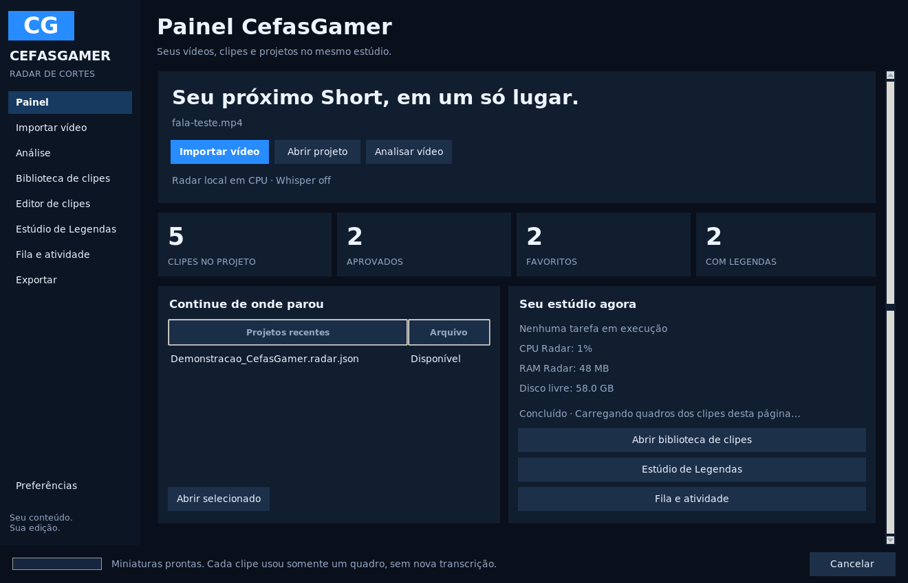
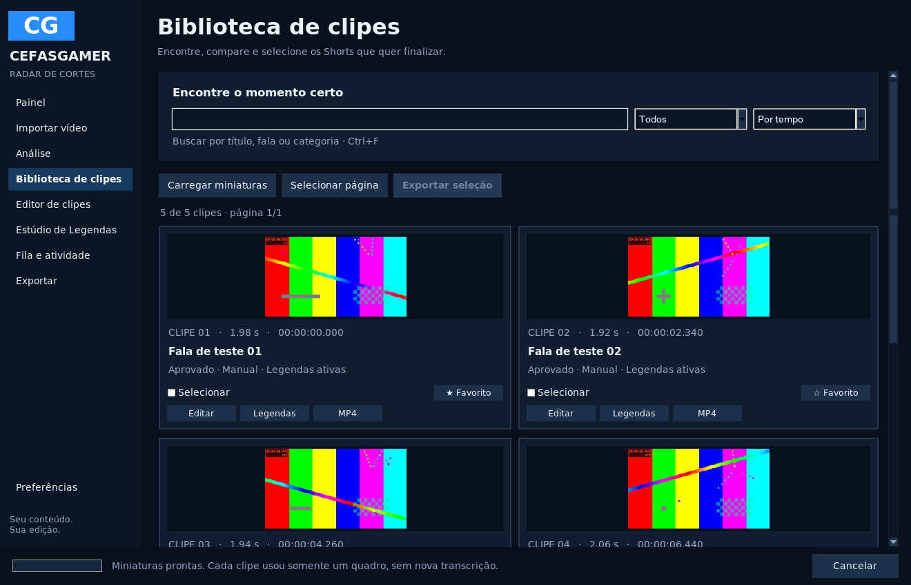
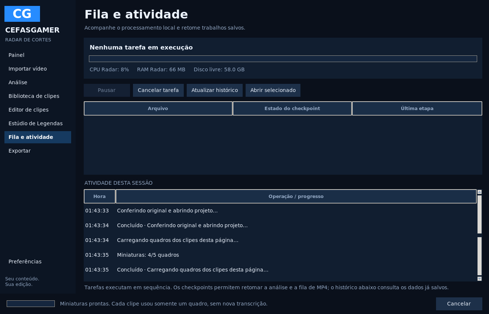

# Radar 0.8.0 — organização inspirada no Clips Studio

Referência solicitada: [ColinGPT9/clips-studio](https://github.com/ColinGPT9/clips-studio), hoje chamado **Clips Kitty**, revisão inspecionada `8990e4aee8ee4a9e667fa3b15aba09d4036039b4`. A inspeção incluiu README, arquitetura, licença AGPL-3.0-or-later, captura pública do painel e organização do frontend Electron/React.

Esta adaptação tem implementação original no Tkinter já usado pelo Radar. A referência orientou a organização da navegação e da biblioteca; os serviços de análise, Whisper, legendas, projetos, FFmpeg e FilmCraft do Radar foram reutilizados. O azul CefasGamer e a distribuição Windows em CPU foram preservados. Nenhuma dependência nova foi adicionada.

| Ideia observada na referência | Adaptação no Radar |
| --- | --- |
| Dashboard com entrada de vídeo e estado do trabalho | **Painel** com importação local, abertura de projetos, contadores reais e atalhos do estúdio |
| Biblioteca de clipes para revisão | **Biblioteca de clipes** com cartões, miniaturas reais, títulos, duração, horários originais, revisão, favoritos e indicação de legendas |
| Busca e organização dos resultados | Busca em título/fala/categoria, ignorando acentos; filtros e ordem por tempo, potencial ou duração |
| Navegação entre clipe, legendas e saída | Ações **Editar**, **Legendas** e **MP4** em cada cartão, integradas aos editores existentes |
| Seleção e fila de renderização | Marcação de clipes em várias páginas/filtros e exportação pela fila MP4 já recuperável do Radar |
| Queue/activity e uso de recursos | **Fila e atividade** com tarefa real, pausa/cancelamento, checkpoints e CPU/RAM do Radar, além do disco livre |

## Usar a nova navegação

O aplicativo abre no **Painel**. **Importar vídeo** leva à análise e suas configurações; **Abrir projeto** recupera a edição salva. Os contadores representam o projeto carregado: clipes, aprovados, favoritos e cortes com legendas salvas. Os projetos recentes indicam se o arquivo ainda está disponível.

Na **Biblioteca de clipes**, use **Carregar miniaturas** para gerar um quadro por clipe da página. São até seis clipes por página; os quadros ficam em cache durante a sessão. Alterar texto/estilo de legenda não refaz a transcrição ou a miniatura. Mudar os limites ou o enquadramento pede outra miniatura, mantendo o vídeo original intacto.

A busca considera título local, fala, categoria e título Gemini quando há revisão válida. **Por potencial** usa a nota editorial disponível e o score local nos demais clipes; a nota continua exigindo revisão humana. **Com legendas** inclui legendas salvas que estejam desativadas. A marcação de clipes é mantida ao trocar página ou filtro: **Exportar seleção** envia todos os marcados, mesmo que parte esteja oculta na busca atual. A quantidade selecionada aparece na navegação da biblioteca.

**Editar** abre o editor existente, **Legendas** abre o Estúdio de Legendas no clipe escolhido e **MP4** usa as configurações atuais de exportação. Projetos antigos continuam abrindo. Legendas editáveis, modos horizontal/vertical, ondas, cortes manuais e FilmCraft permanecem disponíveis.

As capturas usam a aplicação real, uma gravação sintética de validação e cortes manuais de demonstração. Contadores, miniaturas e medições são os dados desse projeto de teste; não são resultados de uma gameplay do usuário ou um benchmark no seu computador.

## Atalhos

| Atalho | Ação |
| --- | --- |
| Ctrl+I | Importar vídeo |
| Ctrl+O | Abrir projeto |
| Ctrl+S / Ctrl+Shift+S | Salvar / Salvar como |
| Ctrl+F | Abrir biblioteca e focar a busca |
| Alt+1 / Alt+2 / Alt+3 / Alt+4 | Painel / Biblioteca / Editor / Legendas |

## Atividade e limites desta adaptação

A tela **Fila e atividade** mostra a operação atual e permite pausar ou cancelar usando os controles existentes. O histórico de checkpoints confere o original antes de carregar um trabalho para retomada. As etapas continuam sequenciais. O painel de eventos guarda até 150 entradas da sessão; o histórico persistente de análise/exportação continua no cache existente.

CPU/RAM são medidas do Radar e seus processos; o disco livre é medido na unidade de cache. Não há exigência de GPU dedicada. As miniaturas e a biblioteca não chamam serviços de IA. A revisão Gemini conserva a configuração e o consentimento anteriores.

Esta entrega adapta a navegação e o fluxo visual. Recursos maiores da referência, como importação por URL, rastreamento automático de pessoa/câmera, monitoramento de canais e publicação em redes sociais, precisam de integração própria e continuam fora desta versão. Não foi substituído o motor do Radar por outro aplicativo.
